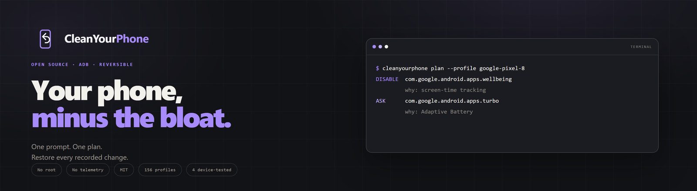
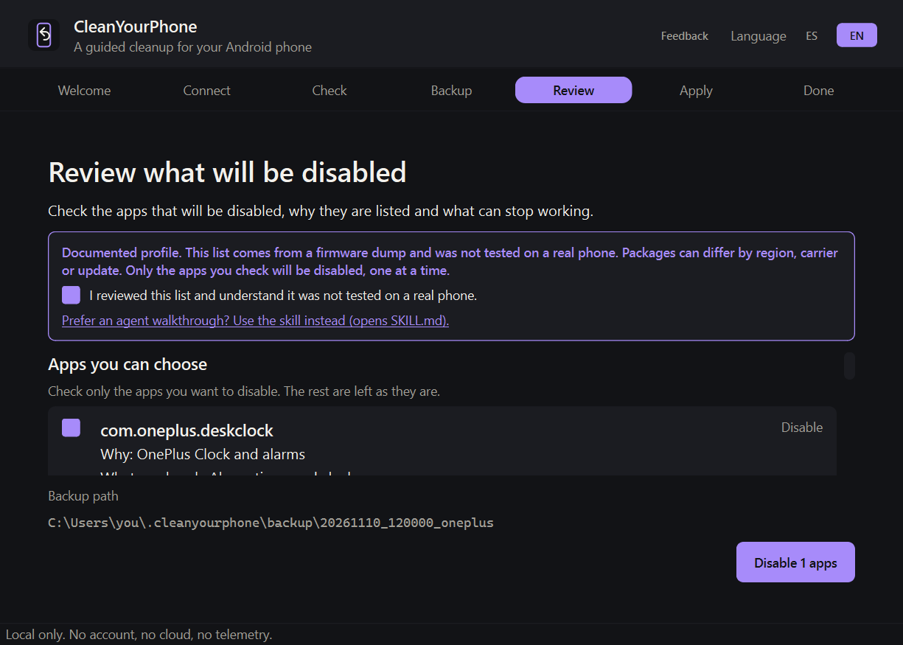
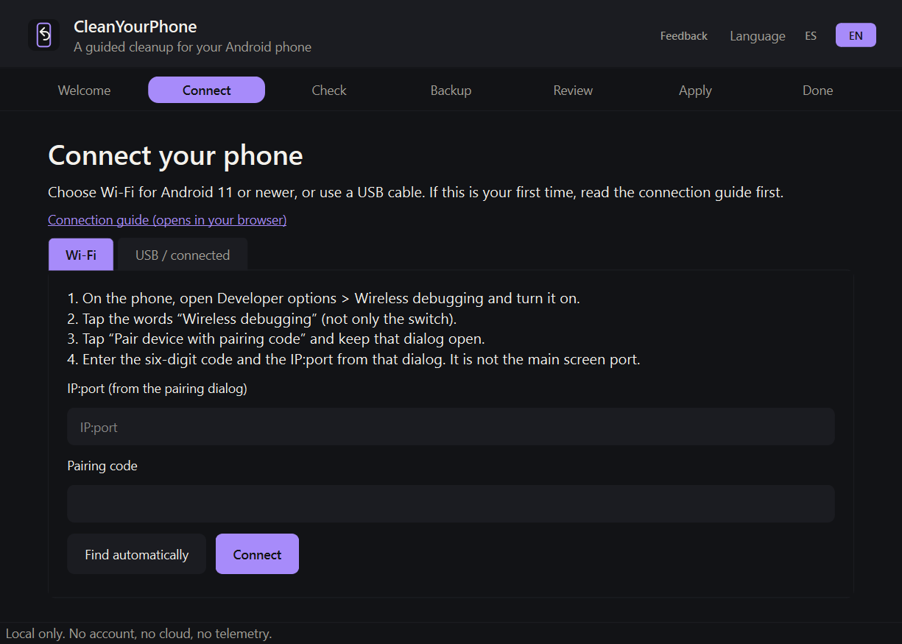

<p align="center">
  <a href="https://cleanyourphone.org/">
    
  </a>
</p>

<p align="center">
  <b>App opcional para Windows</b> ·
  <a href="https://github.com/jparedesDS/cleanyourphone">Skill e CLI</a> ·
  <a href="https://cleanyourphone.org/">Site</a> ·
  <a href="https://cleanyourphone.org/#feedback">Feedback</a>
</p>

<p align="center">
  <a href="README.md">English</a> ·
  <a href="README.es.md">Español</a> ·
  <b>Português (BR)</b> ·
  <a href="README.fr.md">Français</a> ·
  <a href="README.de.md">Deutsch</a> ·
  <a href="README.it.md">Italiano</a> ·
  <a href="README.ja.md">日本語</a> ·
  <a href="README.zh-CN.md">简体中文</a> ·
  <a href="README.zh-TW.md">繁體中文</a> ·
  <a href="README.ko.md">한국어</a>
</p>

<p align="center">
  <a href="https://github.com/jparedesDS/cleanyourphone-app/releases"></a>
  
  
  
  
</p>

# CleanYourPhone app

**O app opcional para Windows da skill CleanYourPhone.** Um fluxo de debloat local e reversível para
quem prefere botões a prompts: conectar, conferir, fazer backup, revisar cada pacote, aplicar em lotes,
verificar e desfazer. A skill continua sendo o produto principal; este app é o caminho simples para os
celulares que ele consegue verificar.

[Baixe o Early MVP](https://github.com/jparedesDS/cleanyourphone-app/releases/latest) ·
[Skill e CLI](https://github.com/jparedesDS/cleanyourphone) ·
[Guia de conexão](https://github.com/jparedesDS/cleanyourphone/blob/main/docs/CONNECT.md) ·
[Feedback](https://cleanyourphone.org/#feedback)

## Status

`v0.2.2` é um Early MVP, só para Windows 10/11 x64 e **sem assinatura de código**. Foi testada de ponta
a ponta em um **OnePlus 6T (Android 11)**: conectar, conferir, backup, revisar, desativar um pacote,
verificar, concluir e desfazer.

O app se recusa a adivinhar de propósito. Ele só continua quando encontra uma correspondência:

| Celular | O que o app faz |
|---|---|
| Perfil `device` exato com uma build listada em `tested` | Fluxo guiado com a lista de pacotes testada. |
| Perfil `documented` que corresponde ao modelo, à família de firmware e à versão do Android | Mostra um aviso, exige uma confirmação explícita e aplica **um pacote por lote**. |
| Mesmo modelo, mas build ou OTA diferente | Para e indica a skill. |
| Sem perfil, celular gerenciado, múltiplos usuários, Android < 8 ou TV | Para e indica a skill ou a documentação de segurança. |

Um perfil `documented` vem de um dump de firmware. É evidência, não um teste em aparelho real; os
pacotes podem variar por região, operadora ou atualização.

<p align="center">
  
</p>

## O que ele faz

- **Wi-Fi ou USB.** Pareie Android 11+ pela Depuração sem fio ou use um cabo de dados. O app encontra o
  celular, confere a build e mantém um único transporte durante a sessão.
- **Checagem de perfil exato.** Mostra modelo, versão do Android, build, bateria, perfil e se a build
  pode ser auto-aplicada.
- **Backup obrigatório.** Lista de pacotes, papéis, ajustes e `getprop` antes da primeira mudança.
- **Revise cada pacote.** `DISABLE`, `ASK`, `BLOCKED` e `SKIP`, com o motivo de estar na lista e o que
  pode quebrar. Nada é desativado sem uma seleção revisada.
- **Lotes e verificação.** Cinco pacotes por lote para um perfil `device`; um por lote para um perfil
  `documented`, com uma checagem do celular depois de cada um.
- **Desfaça o journal inteiro.** Uma ação restaura todas as mudanças que o app registrou para aquele
  celular, incluindo sessões anteriores. O backup é o plano B.
- **DNS privado opcional.** Presets AdGuard, AdGuard Family, Control D e Mullvad, além de uma checagem
  que não afirma que anúncios do YouTube estão bloqueados. Veja
  [docs/ADS.md](https://github.com/jparedesDS/cleanyourphone/blob/main/docs/ADS.md).
- **Benchmark opcional antes/depois.** RAM livre, processos e contagem de pacotes, tudo local.
  Aproximado, não causal; nenhum serial ou fingerprint é armazenado.
- **Feedback opcional.** Um checklist preenchido e editável pode ser enviado ao mantenedor após
  consentimento explícito. Sem telemetria automática. Veja
  [docs/FEEDBACK.md](https://github.com/jparedesDS/cleanyourphone/blob/main/docs/FEEDBACK.md).
- **Checagem de atualização.** No máximo uma vez a cada seis horas, o app consulta o GitHub para saber
  qual é a versão mais recente. Se existir uma versão mais nova, um banner abre a página do release. O
  app nunca baixa nem instala uma atualização por conta própria, e não envia dados de conta, celular ou uso.

<p align="center">
  
</p>

## Instalação

Baixe o `CleanYourPhone-Setup-0.2.2.exe` em
[releases/latest](https://github.com/jparedesDS/cleanyourphone-app/releases/latest), ou compile
localmente.

SHA-256 do instalador publicado da `v0.2.2`:

```text
B5F70B2DBDF78F05B6637FB9671C4233F4C5E513EC9F51F0EF60798C94A8B30E
```

O instalador é por usuário, cria um atalho no Menu Iniciar e não exige direitos de administrador. Ele
instala em `%LOCALAPPDATA%\Programs\CleanYourPhone`.

O Windows SmartScreen pode mostrar **"O Windows protegeu seu PC"** porque a build não é assinada.
Escolha **Mais informações → Executar mesmo assim** só depois de verificar o download e o SHA-256. Não
desative o SmartScreen.

Se for sua primeira vez com ADB, siga o
[guia de conexão](https://github.com/jparedesDS/cleanyourphone/blob/main/docs/CONNECT.md). Ele cobre a
tela oculta da Depuração sem fio, a porta de pareamento versus a porta de conexão, cabos USB de dados,
drivers do Windows e o ajuste de versão para desktop no navegador.

Desinstalar remove os arquivos e atalhos do app. Ele deixa de propósito o journal de desfazer e os
backups do celular em `%USERPROFILE%\.cleanyourphone`, e as configurações em
`%LOCALAPPDATA%\CleanYourPhone`.

O ADB não é incluído nem redistribuído. O app encontra uma instalação existente do Platform-Tools ou
baixa o arquivo oficial do Google na primeira execução. Veja
[THIRD_PARTY_NOTICES.md](THIRD_PARTY_NOTICES.md).

## Modelo de segurança

O app é uma GUI sobre a mesma CLI; as proteções não mudam:

- **Desativar, nunca desinstalar.** Somente `pm disable-user --user 0`; `pm enable` é o desfazer.
- **Sem root, sem ROM customizada, sem desbloqueio de bootloader, sem Shizuku.**
- **Sem backup, sem mudanças.** O botão de aplicar fica desativado sem um backup verificado.
- **Pacotes protegidos e papéis são recusados.** Telefonia, Play Services, WebView, permission
  controller, alertas de emergência, o discador atual, SMS, Home e teclado não podem ser desativados.
- **Um transporte por sessão.** Trocar entre Wi-Fi/USB no meio da sessão é recusado; comece uma nova
  sessão.
- **Pare no desconhecido.** Aparelhos gerenciados, múltiplos usuários, Android < 8, TVs e celulares sem
  perfil correspondente não são alterados.
- **Sem telemetria automática.** O app é local. As únicas chamadas de rede são o download opcional do
  Google Platform-Tools, a checagem de atualização do GitHub e o formulário de feedback depois que a
  pessoa aperta Enviar.

## Build

Requisitos: Windows 10/11 x64, Python 3.12+, Git e Inno Setup 6
(`choco install innosetup -y` ou <https://jrsoftware.org/isdl.php>).

```powershell
powershell -ExecutionPolicy Bypass -File scripts/build-app.ps1
```

O script:

1. clona a tag fixada da CLI (`v0.3.4`);
2. congela a CLI como sidecar onedir;
3. prepara os 157 perfis;
4. congela o app PySide6;
5. faz smoke test dos dois executáveis;
6. compila o instalador por usuário.

Saídas:

- `dist/CleanYourPhone/CleanYourPhone.exe` (app portátil onedir)
- `dist/CleanYourPhone-Setup-0.2.2.exe` (instalador)

Defina `CLEANYOURPHONE_CLI` para o sidecar congelado e rode
`python -m pytest tests/test_cli_contract.py` para incluir o teste de contrato com o sidecar real.

## Desenvolvimento

```powershell
python -m pip install -e ".[dev]"
python -m pytest -q
python -m cleanyourphone_app --version
```

A suíte do app cobre as proteções de conexão, a fixação de serial, a confirmação de perfil documentado,
a aplicação de um por lote, o bloqueio por backup, o desfazer, os payloads de feedback, o consentimento
de feedback e os textos da interface. O resultado publicado da suíte `0.2.2` é **526 passed, 6 skipped**.

## Mapa do repositório

| Caminho | O que é |
|---|---|
| `src/cleanyourphone_app/domain/` | Regras puras: decisão de suporte, modelo de revisão, sessão, lotes, payload de feedback. |
| `src/cleanyourphone_app/services/` | Localizador de ADB, pareamento Wi-Fi, cliente da CLI, downloads, cliente HTTP de feedback, logging, configurações. |
| `src/cleanyourphone_app/ui/pages/` | Conectar, conferir, backup, revisar, aplicar, concluir, setup, boas-vindas, bloqueado. |
| `src/cleanyourphone_app/ui/dialogs/` | Diálogo de feedback opcional. |
| `scripts/build-cli-sidecar.ps1` | Compila o sidecar fixado da CLI e prepara os perfis. |
| `scripts/build-app.ps1` | Compila o app, faz smoke test e compila o instalador. |
| `packaging/installer.iss` | Instalador Inno Setup por usuário. |
| `docs/superpowers/` | Design histórico e plano de implementação. |
| `tests/` | Suíte Pytest; 526 passando, 6 ignorados em `0.2.2`. |

## Limitações

- Só Windows 10/11 x64. Ainda não há app de desktop para macOS ou Linux.
- A build não tem assinatura de código.
- Só oferece suporte aos perfis e builds exatos acima; qualquer outro celular é enviado para a skill.
- O modo `documented` é coberto pela suíte do app, mas ainda não por um aparelho `documented` físico.
- O ADB ainda exige Opções do desenvolvedor e um computador autorizado.

## Links

- **Skill e CLI:** <https://github.com/jparedesDS/cleanyourphone>
- **Site:** <https://cleanyourphone.org/>
- **Guia de conexão:** <https://github.com/jparedesDS/cleanyourphone/blob/main/docs/CONNECT.md>
- **Feedback e privacidade:** <https://github.com/jparedesDS/cleanyourphone/blob/main/docs/FEEDBACK.md>
- **Perfis:** <https://github.com/jparedesDS/cleanyourphone/tree/main/profiles>
- **Segurança:** <https://github.com/jparedesDS/cleanyourphone/blob/main/docs/SAFETY.md>

## Licença

MIT. Veja [LICENSE](LICENSE). Avisos de terceiros estão em
[THIRD_PARTY_NOTICES.md](THIRD_PARTY_NOTICES.md).
